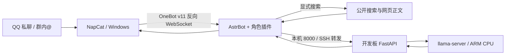

# orangepi-rpg-aichat

在香橙派 AIpro 上运行本地 GGUF 语言模型，通过 Windows 上的 AstrBot + NapCat 接入 QQ，作为可改人格的角色聊天机器人。

当前实现处理文字消息，带浏览器聊天页面和 OpenAI 风格接口。语音识别、语音合成、图片理解与 RAG 尚未接入。

## 能做什么

- 仅允许配置的主号私聊、配置的群真实 @ 机器人；拦截通知、空消息、重复消息、@全体和文本伪造 @。
- 群间共享限频、按群冷却；模型忙时不积压问题。
- 分离公开与主号私聊人格，保留约两轮上下文，注入北京时间。
- 短回复提示：日常目标一句10–30字，解释/搜索最多两句60字；160 token输出预算，并识别实际截断。
- 精确关键词直接回复，不调用模型。可选低频一两字冒泡，公开默认关闭。
- 显式搜索并读取网页正文，回复附真实来源；联网开关仅主号私聊可改。
- 开发板 systemd 服务、Windows 登录后 SSH 转发和 QQ 运行守护。

## 快速开始

完整步骤见 **[部署指南](docs/deployment.md)**。仓库中的账号、群号和 SSH 地址均需由部署者填写；没有预置 QQ 登录态、密码、访问令牌或模型权重。

1. 在开发板编译固定版本的 llama.cpp，安装板端 API，另行取得兼容 GGUF 权重。
2. 在 Windows 安装 Python 3.12+、AstrBot 和 NapCat，初始化本地运行目录。
3. 复制 `config/deployment.example.json` 为 `config/deployment.local.json`，填写自己的机器人号、主号和群白名单，再运行 `tools/configure.py`。
4. 配置 SSH 转发，扫码登录 QQ，运行 `tools/connect-napcat.py`，确认回复后再安装 Windows 登录启动项。

## 已验证的环境与边界

原部署硬件为 Orange Pi AIpro 20T、Ascend 310B1、四核 ARM CPU、约24GB共享内存。日常模型为 Qwen3.5-9B Q4_K_M，运行于 ARM CPU；这个模型在本项目中没有使用昇腾 NPU。量化格式 Q4_K_M 也不等于 W4A4。

原机实测约1.6 tokens/s，带完整角色提示的回复可等待约三分钟。缩短回答能减少解码量，但没有解决 CPU 处理提示词的延迟。较小模型可自行替换，需验证其 GGUF、聊天模板及后端兼容性。

原机已完成真实模型聊天、QQ 模拟传输、开发板正常重启、进程恢复和 QQ 缓存登录验证。公开版把个人账号抽成配置，并增加全新部署脚本；[验证说明](docs/verification.md)区分了原机实测与整理后的自动测试，没有把原机结果当作所有新机器的保证。

## 目录

| 位置 | 内容 |
| --- | --- |
| `board/` | CPU GGUF API、网页、固定版本编译脚本、systemd 安装 |
| `plugins/astrbot_plugin_orangepi_roleplay/` | AstrBot 角色、权限、搜索、冒泡和截断保护 |
| `config/` | 脱敏的部署与 SSH 示例 |
| `tools/` | 配置生成、NapCat 本地面板准备与连接 |
| `experiments/qq-bridge/` | 沿用已验证的 Windows 后台启动、恢复脚本 |
| `tests/` | 合成身份的权限、搜索、配置与输出测试 |
| `docs/` | 部署、验证与依赖说明 |

## 使用

主号私聊发送 `开启联网`、`关闭联网`、`联网状态` 管理开关。已开启时，授权会话中的 `搜一下 内容`、`搜索 内容`、`查一下 内容` 才触发搜索。普通闲聊不会自动联网。搜索需要 Windows 电脑可访问公开网络，不依赖付费 API Key；默认每日最多30次尝试是本地限频设置。

群内真实 @ 后发送 `区` 直接回 `区`。关键词位于插件的 `activities.json`。启用冒泡须设置 `enable_bubbles=true` 后重新配置；限北京时间10:00–23:00，随机90–180分钟，每群每日最多3次尝试，重启保留时间表。

人格示例位于插件的 `whale-public.txt` 和 `whale-private.txt`。可以替换为自己的角色；不要把账号认证或权限判断放进人格提示词。

## 依赖与许可

本仓库自有代码使用 [MIT](LICENSE)。AstrBot、NapCat、llama.cpp、QQ 客户端和模型各自遵循上游许可与使用条件，不随本仓库分发。固定版本、来源和模型校验信息见 [依赖说明](docs/dependencies.md)。
